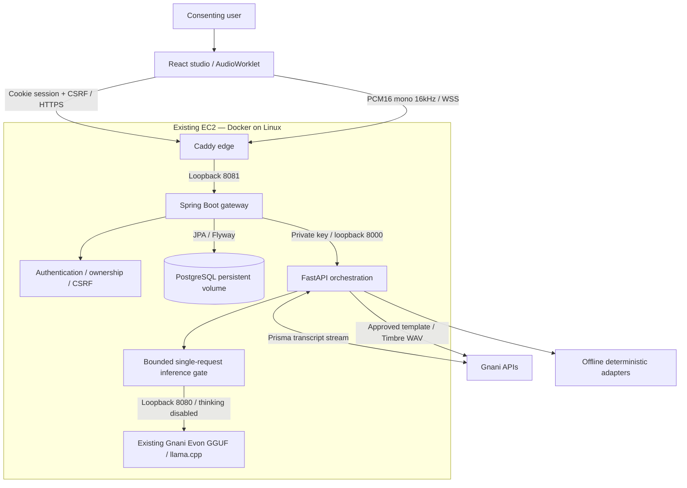
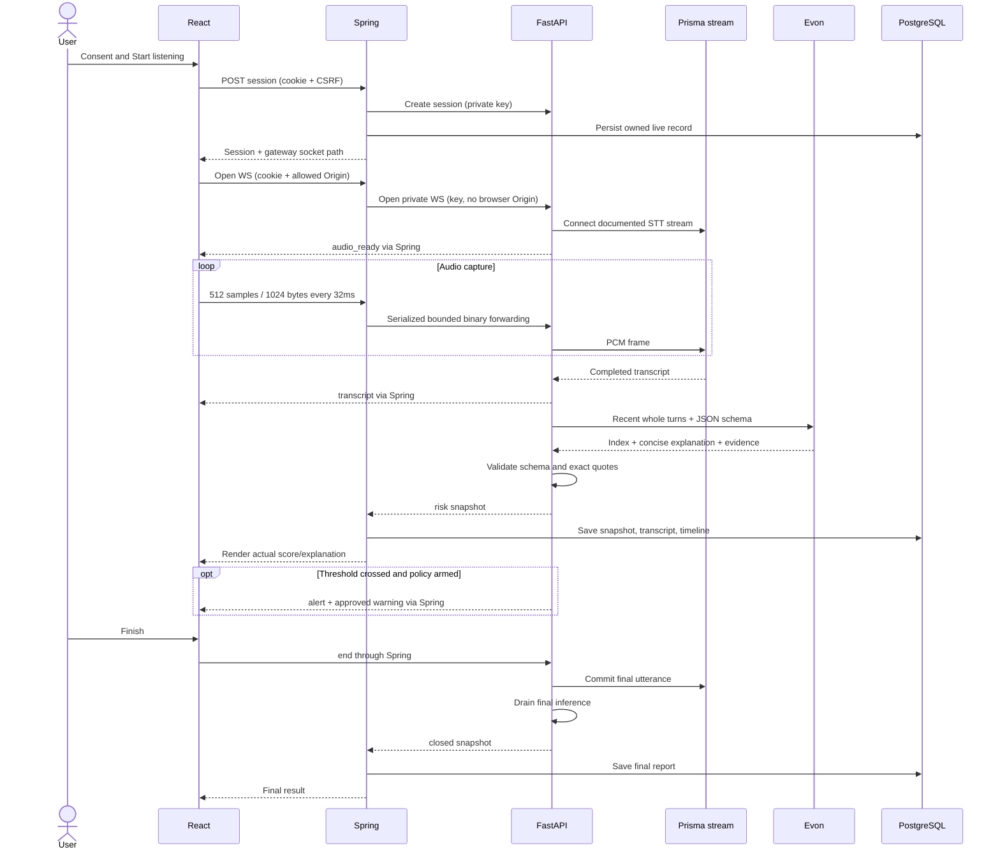
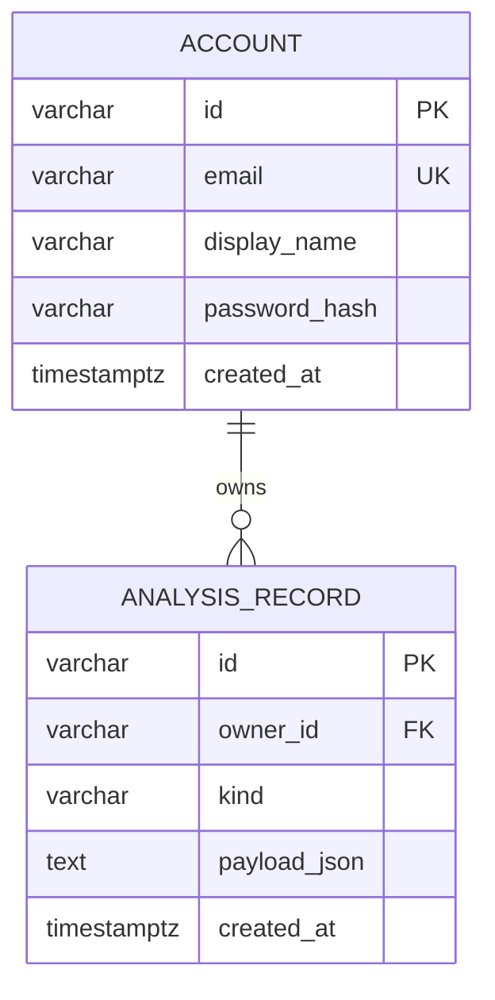

# CallShield full-stack architecture

These diagrams describe the implemented React/Spring/Python extension. The earlier architecture pack describes the original v1 Python service.

```mermaid
stateDiagram-v2
    [*] --> Waiting: Session created
    Waiting --> Assessing: Completed transcript
    Assessing --> Assessed: Valid structured result
    Assessing --> Undetermined: Timeout / invalid provider output
    Assessed --> Assessing: New conversational evidence
    Undetermined --> Assessing: New evidence / retry checkpoint
    Assessed --> Alerted: Index >= threshold and armed
    Alerted --> Assessed: Show one in-app alert
    Assessed --> Armed: Index < reset and cooldown elapsed
    Armed --> Assessing: New evidence
    Waiting --> Closed: Finish
    Assessed --> Closed: Finish and drain
    Assessing --> Closed: Final checkpoint completes
    Assessed --> Interrupted: Connection lost; saved result marked stale
    Closed --> [*]
    Interrupted --> [*]
```

`payload` stores the JSON assessment/transcript and bounded timeline, not raw audio. Session cookies and CSRF tokens are never model inputs. Provider keys remain on servers. Scores are uncalibrated indices; measured vocal amplitude does not imply deception. The no-domain deployment binds Caddy to loopback 8090 and is reached through SSH; public deployment uses a DNS name with HTTPS on 443.
