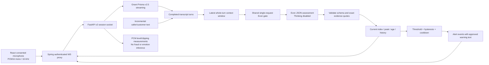

# Live risk assessment v2: implementation and integration

**Multilingual update:** the studio now exposes 11 Evon text languages plus Hinglish, ten explicit Prisma audio locales, and a separate `explanationLanguage` selection. Evidence stays in the original script. The English/Hindi-only descriptions below record the initial v2 scope; see [REAL_TESTING.md](REAL_TESTING.md) and `/api/capabilities` → `studio` for the updated catalog and real-provider tests. Warning templates remain English/Hindi.

This extension adds incremental text and PCM audio sessions, a 0-100 model-assessed risk index, five severity bands, short evidence-linked explanations, and threshold alerts. **The existing `/api/v1` contracts remain intact.** No model was trained or replaced. Evon remains the real LLM; reasoning mode stays disabled. Its new JSON content contains a concise user-facing assessment, not internal chain-of-thought.

## What is implemented

- `POST /api/v2/analyze/text`: structured risk assessment of ordered turns.
- `POST /api/v2/sessions`: create a consented text or audio session.
- `POST /api/v2/sessions/{id}/turns`: append completed text turns without resending prior conversation.
- `GET /api/v2/sessions/{id}`: latest assessment, bounded score history and retained turns.
- `POST /api/v2/sessions/{id}/end`: finish a text session without an attached socket.
- `WS /api/v2/sessions/{id}/stream`: bidirectional audio/text input and transcript, risk, alert, status and failure events. When connected, end through this socket, not REST, to allow final speech draining.

The live language set is English (`en-IN`), Hindi (`hi-IN`), and text-only Hinglish (`hi-Latn`). Live text is preserved and assessed directly by multilingual Evon; the v1 Google normalization policy is not applied in this extension. Audio requires `en-IN` or `hi-IN`. There is no live translation or invented speaker diarization.



## Score and explanation semantics

The score is an **uncalibrated model risk index**, not a fraud probability, confidence percentage, or validated statistical predictor. Output explicitly includes `scoreType=uncalibrated_model_risk_index`, `calibrated=false`, and `confidence=null`. Do not display "90% chance of fraud". A reasonable UI label is **Risk index: 90 / 100**.

| Index | Band |
|---|---|
| 0-19 | MINIMAL |
| 20-39 | GUARDED |
| 40-59 | SUSPICIOUS |
| 60-79 | HIGH |
| 80-100 | CRITICAL |

The model receives ordered speaker-labelled turns and a rubric covering intent, protective negations, coercion, secrecy, emergency money demands and impersonation. A family relationship claim alone does not verify identity or make credential sharing safe. Model output includes a short summary plus 1-3 exact evidence quotes linked to turn IDs. The server rejects out-of-range/non-integer scores, malformed/truncated JSON, invalid scenarios, missing evidence and quotes not present in the analyzed window. Quote matching verifies textual grounding; it does not prove the summary or judgment is correct. No raw `reasoning_content` is used.

Scenario values: `credential_theft`, `impersonation`, `financial_coercion`, `emergency_scam`, `remote_access`, `investment_scam`, `other`, `none`, `unclear`. These describe the suspected scenario, not proven crimes or identities. Real semantic accuracy must be evaluated on representative labelled conversations, including legitimate requests, corrections, family impersonation and adversarial instructions.

`acoustics` contains measured RMS level, peak amplitude, clipping fraction and received duration. It explicitly says `usedByRiskModel=false`, `fraudInference=false`, and `toneInference=not_available`. These are audio quality/vocal amplitude measurements, not emotion, stress, truthfulness, accent-based fraud or speaker identity detection. Linguistic urgency/coercion is considered by Evon from text. A validated acoustic deception/emotion model has not been added, and audio loudness does not change the risk index.

## Update cadence and bounded context

One-second **status heartbeats** are independent of new model results. A new score requires new completed transcript evidence and successful inference. The default checkpoint interval is a minimum of one second between starts, not an inference deadline. New turns arriving during inference are coalesced into the next checkpoint; there is no growing queue of per-second model jobs. Legacy v1 requests and v2 assessments share the same single-outstanding Evon request gate.

Prisma uses VAD and a maximum uninterrupted segment of five seconds (configurable, 5-30 seconds), with 400 ms silence segmentation. Speech recognition latency plus Evon generation can exceed one second, especially on the existing four-vCPU CPU-only instance. The transport does not guarantee a freshly inferred score every second. Never animate changing fabricated scores during silence or inference. Display `assessmentAgeMs`, `assessedRevision`, `inputRevision`, and `stale` alongside a processing indicator.

Current scores may rise or fall; `peakScore` separately retains the maximum successfully observed score in this session. The assessor keeps the most recent **whole turns** fitting the configured context, preserving their order. `window.includedTurnIds`, `omittedTurnIds`, `policy=latest_whole_turns`, and `contextLimited` make omissions explicit. Older fraud evidence can fall outside the window; a low current score after omission does not erase the peak/history. No model-generated memory summary is fabricated, and individual turns are never silently clipped.

## Configure real Evon before v2

The old `-c 512` deployment is too small for a JSON explanation and context. The v2 creation/assessment endpoints return `CONTEXT_LIMIT_EXCEEDED` before paid inference when input cannot fit. Increase **both** the actual llama-server context and Python's limit together; start by trying 4096 and measure memory/latency:

```bash
# On EC2: stop the existing foreground llama-server, then restart with its actual path.
"$LLAMA_SERVER" \
  -m "$HOME/evon-model/gnani-evon-v3.3-30B-A3B-Q3_K_S.gguf" \
  --alias evon --host 127.0.0.1 --port 8080 -ngl 0 -c 4096 -t 4 --parallel 1
```

`LLAMA_SERVER` must be the executable path you already located in the EC2 session. Python never starts AWS or downloads a replacement model. Keep the SSH tunnel/private access and port 8080 protection as before.

```dotenv
MOCK_MODE=false
EVON_CONTEXT_TOKENS=4096
LIVE_ENABLED=true
LIVE_CHECKPOINT_SECONDS=1
LIVE_STT_MAX_SPEECH_SECONDS=5
RISK_MAX_TOKENS=256
```

Preserve your real `APP_API_KEY`, Gnani key and reachable `EVON_BASE_URL`. Existing llama.cpp must support schema-constrained `response_format`; an unsupported contract returns an explicit upstream failure. Evon always receives `enable_thinking=false`. Structured inference may need significantly longer than the former single-letter result; inspect timing and CPU load before promising an update rate.

## First test: structured text in Postman

```http
POST /api/v2/analyze/text
X-API-Key: <your existing backend key>
Content-Type: application/json
```

```json
{
  "turns": [
    {"id":"t1","speaker":"caller","text":"I am calling from your bank."},
    {"id":"t2","speaker":"customer","text":"What do you need?"},
    {"id":"t3","speaker":"caller","text":"Tell me your OTP now or your account will be blocked."}
  ]
}
```

The response is `{"status":"COMPLETED","assessment":{...},"mock":false}`. Numeric values and explanations are generated by the actual model, not fixed promised predictions. With mock mode true the fixture-based assessor demonstrates the same contract without provider calls.

## Session creation and socket messages

```http
POST /api/v2/sessions
X-API-Key: <backend key>
Content-Type: application/json
```

```json
{
  "consent": true,
  "inputMode": "text",
  "inputLanguage": "en-IN",
  "warningLanguage": "en-IN",
  "alerts": {"threshold":70,"resetBelow":50,"cooldownSeconds":30}
}
```

Returns HTTP 201 with `sessionId` and `websocketPath`. Open a Postman WebSocket connection to `ws://127.0.0.1:8000` plus that path, supplying `X-API-Key` in its handshake headers. Do not set `Origin`: this is a private server-to-server socket. Query-string API keys are not accepted.

After the `ready` event, send completed text turns:

```json
{"type":"turn","id":"t1","speaker":"caller","text":"Hello, how are you?"}
```

```json
{"type":"turn","id":"t2","speaker":"caller","text":"Tell me your OTP now."}
```

Wait for a score if you want to observe each checkpoint, or send turns as they arrive and allow coalescing. Turn IDs must be unique; replay of an identical ID/text/speaker is idempotent, while changing an existing ID fails. Speaker is `caller`, `customer`, or `unknown`; it is supplied metadata, not verified speaker recognition. Maximum 1000 characters per turn and 20 completed turns/second; empty/nonmeaningful/invalid Unicode text is rejected.

Finish with:

```json
{"type":"end"}
```

The service finishes the pending checkpoint and emits `closed`. Disconnecting cancels pending work and closes this session; reconnect by creating a new session, rather than assuming audio replay or durable recovery. Retrieve the retained snapshot/history with GET. REST text turn ingestion is also available for Spring services which already produce transcripts.

## Live audio protocol

Create with `inputMode=audio`, `consent=true` and an explicit `en-IN`/`hi-IN` locale. Wait for both `ready` and **`audio_ready`** before sending:

- Binary WebSocket frames of **exactly 1024 bytes**.
- Raw signed 16-bit little-endian PCM, mono, **16,000 Hz**.
- 512 samples/frame, at approximately **32 ms/frame**.
- No WAV/MP3 header, WebM/Opus MediaRecorder blob, base64 or entire uploaded file.

The server enforces frame size and bounded real-time pacing, performs acoustic measurements, and forwards frames to Gnani's documented `/stt/v3/stream` endpoint. Provider headers pin `model=prisma-v2.5`; this does not switch to Prisma v3.0. Final transcript events append ordered turns with `speaker=unknown` and stable IDs derived from provider segment IDs. Audio sessions reject client-supplied text turns to avoid mixing unverified and provider evidence.

Send the `end` JSON control frame after the final PCM frame. The server sends Gnani's documented `commit` control, waits three seconds for remaining segments, then closes the provider and completes pending risk inference. Prisma v2.5 has no final-commit acknowledgement in this integration; `sttFinalization=best_effort_commit_drain` reports that bounded drain honestly. Delayed provider segments can still be missed; evaluate this on real speech and silence boundaries. No partial transcript is invented to fill the gap.

Mock audio returns one fixed, explicitly mocked OTP-request transcript after 32 frames, irrespective of the audio content. Acoustic measurements still describe the received PCM; mock transcription and scoring do not represent real interpretation of the microphone.

## Events and UI rules

| Event | Meaning |
|---|---|
| `ready` | Session socket accepted |
| `audio_ready` | Streaming speech adapter connected; audio may start |
| `transcript` | New completed turn, revision and transcription provenance |
| `classifying` | Checkpoint started for a revision |
| `risk` | New assessment + score/band/summary/evidence + snapshot |
| `alert` | Threshold policy triggered; includes approved warning text |
| `status` | One-second snapshot; may contain an unchanged/stale score |
| `error` | Sanitized operational failure; never interpret as safe |
| `closed` | Final session snapshot |

An assessment includes `score`, `band`, `scenario`, `explanation`, `explanationSource`, exact `evidence`, `source`, `mock`, `model`, `confidence=null`, `scoreType`, `calibrated=false`, `window`, and `acousticInfluence=false`. The session adds `peakScore`, `assessmentAgeMs`, `inputRevision`, `assessedRevision`, `riskStatus`, `stale`, error state, and acoustic measurements. No random interpolation or changing confidence is generated.

`riskStatus=UNDETERMINED` or `stale=true` means the current assessment is not current/available; a previously observed score may be retained for history. Do not silently display it as a fresh successful result. After STT failure the service suppresses new alerts even if a pending model result completes. A rate-limited or invalid model checkpoint is not automatically replayed without new evidence.

Alerts are emitted at/above `threshold`, once per armed high-risk episode. Reset requires a successful current score **strictly below** `resetBelow`; cooldown must also elapse. Persistent high risk does not repeatedly alert each second. Scores/bands still update below the alert threshold. Stale model results do not trigger alerts. Policy limits are validated, and `resetBelow` must be lower than `threshold`. These are decision thresholds over an uncalibrated index, not probability cutoffs. Tune them against a labelled evaluation set before deployment.

Warning text is server-owned and localized to `warningLanguage` (English/Hindi). Live alert events do not automatically make paid Timbre calls. v1 warning-audio routes accept v1 analysis IDs, not v2 session IDs; automatic live speech alerts are not wired in this extension.

## Executable client and local checks

Start the service with bounded socket frames/queues (preserving your selected mock/real environment):

```powershell
.\.venv\Scripts\python.exe -m uvicorn app.main:app --host 127.0.0.1 --port 8000 --workers 1 --no-access-log --ws-max-size 8192 --ws-max-queue 8
```

With a mock server running, this client sends incremental text, waits for each score, prints score/alert metadata, and ends the session:

```powershell
.\.venv\Scripts\python.exe -m scripts.smoke_test_live
```

Expected mock sequence: **10 -> 40 -> 90 -> 10**, with one alert at 90 and peak score retained at 90. This sequence is fixture logic, not an assertion about Evon's real accuracy.

For a running real server, retain your real settings and explicitly opt in:

```powershell
$env:RUN_REAL_INTEGRATION = 'true'
.\.venv\Scripts\python.exe -m scripts.smoke_test_live
```

For audio, convert a consented test clip locally, then stream it in paced frames:

```powershell
& $env:FFMPEG_PATH -i 'C:\path\consented-clip.wav' -ac 1 -ar 16000 -c:a pcm_s16le live-input.wav
.\.venv\Scripts\python.exe -m scripts.smoke_test_live --audio live-input.wav --language en-IN
```

The file client simulates real-time capture by pacing individual frames; it does not upload the entire audio to the service. Actual microphone capture must use an AudioWorklet or equivalent PCM pipeline in the teammate's client. Native browser WebSocket cannot set the backend secret header: authenticate the user at Spring, authorize session ownership there, and forward the private socket with the server-held key. Never embed that secret in React or query parameters. No covert interception or operating-system call capture is added.

```powershell
.\.venv\Scripts\python.exe -m scripts.run_tests
.\.venv\Scripts\python.exe -m ruff check . --no-cache
```

## Operational boundaries

Defaults: ten retained sessions; 15-minute session expiry; 200 turns/session; 100 stored checkpoints; 64 queued socket events. A slow consumer can lose old queued events, while GET still exposes bounded checkpoint history and the latest snapshot. Alerts are ephemeral WebSocket events, not durable notifications. Persist events/results in Spring if durable delivery is required. Sessions/history are process-local; run one Uvicorn worker per Evon server. Audio ingestion does not retain the raw stream. Text and evidence remain sensitive in memory until expiry/shutdown.

The new real streaming contract and structured JSON payloads are tested with intercepted provider transports, and live text/audio flows are exercised against a local mock Uvicorn server. No new paid cloud tests or remote EC2 changes are performed automatically. The previously supplied v1 architecture PDF describes the original M0-M5 implementation; the Mermaid diagram here covers this extension.

References checked for this extension: [Gnani realtime STT](https://docs.gnani.ai/api/STT/stt-websocket), [official Gnani SDK/source](https://github.com/Gnani-AI-Mintlify/gnani-vachana), and [llama.cpp structured chat / template controls](https://github.com/ggml-org/llama.cpp/blob/master/tools/server/README.md).
