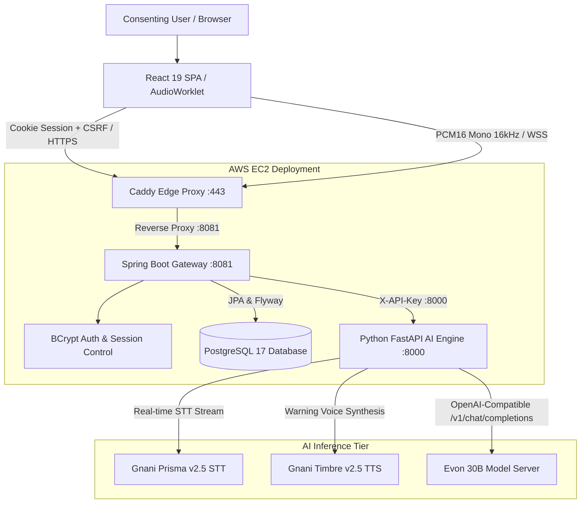
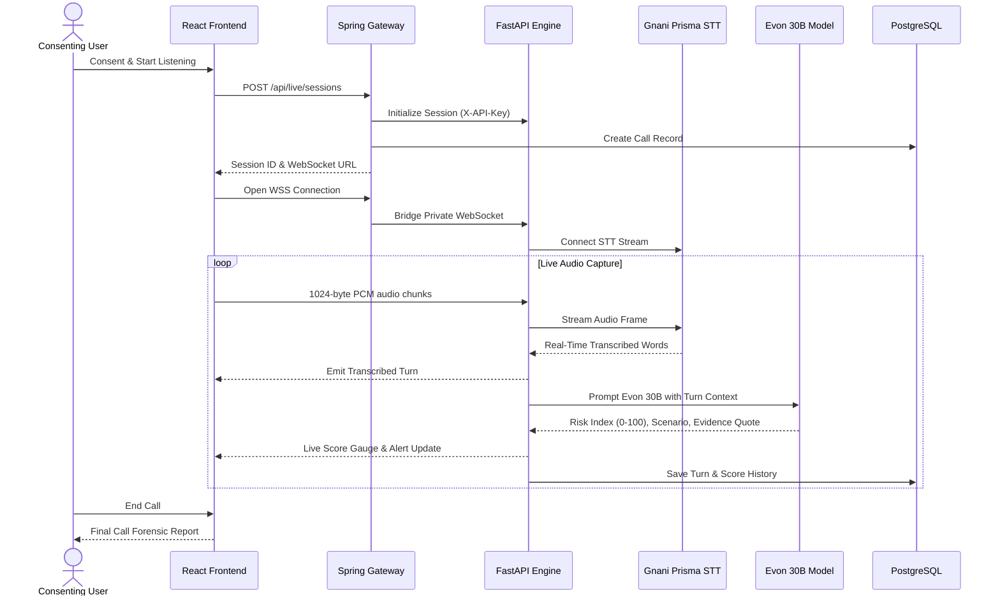

# 🛡️ CallShield AI
### Real-Time Conversational Fraud Defense Powered by Gnani Voice AI & Evon 30B

[](https://callshiel.me)
[](gateway/)
[](app/)
[](deploy/)
[]()
[]()

---

## 📌 Executive Summary

Every year, Indian citizens lose over **₹1,700+ Crores** to conversational telecom fraud — including digital arrest threats, courier parcel interception, fake bank KYC suspensions, and emergency money scams.

Traditional rule engines and keyword blockers **fail** because modern fraudsters do not just send suspicious words; they apply **psychological coercion, emotional panic, and rapid conversational manipulation in native Indian languages**.

**CallShield AI** is an enterprise-grade, privacy-first fraud prevention system. It listens to live or pre-recorded calls (with verified user consent), streams audio through **Gnani Prisma** for multilingual Indian speech recognition, and evaluates conversational intent turn-by-turn using the **Evon 30B Indian Foundation Model**. When fraud is detected, it generates actionable evidence quotes, calculates a granular risk index (0–100), and emits audible safety warnings via **Gnani Timbre**.

> 🌐 **Live Cloud Demo**: [https://callshiel.me](https://callshiel.me)

---

## 🏛️ System Architecture

CallShield AI runs as a production containerized multi-tier stack on AWS:



### Component Breakdown

1. **Edge Reverse Proxy (Caddy v2)**:
   * Public HTTPS termination on `callshiel.me` with automated Let's Encrypt SSL/TLS certificates.
   * HTTP/2 transport and low-latency WebSocket routing for live microphone streaming.
2. **Security Gateway (Spring Boot 3.5 & Java 21)**:
   * User registration, authentication, and BCrypt credential hashing.
   * HTTP-only session cookies with strict CSRF protection.
   * PostgreSQL persistence for call records, timestamps, fraud scores, and audit trails.
3. **AI Orchestration Engine (FastAPI & Python 3.12)**:
   * Ephemeral memory buffering (no unencrypted raw audio is saved to disk).
   * Audio normalization (`ffmpeg` & `ffprobe`) converting inputs into 16 kHz mono PCM.
   * Rate limiting, token budget management, and JSON schema validation.
4. **Speech-to-Text (Gnani Prisma v2.5)**:
   * State-of-the-art multilingual transcription optimized for Indian accents, code-mixed speech, and 10+ Indic languages.
5. **Contextual LLM Reasoning (Gnani Evon 30B)**:
   * Evaluates psychological pressure, credential solicitation, and coercion rather than surface keywords.
   * Understands negation (e.g. *"Never share your OTP with strangers"* is correctly recognized as **Safe**).
6. **Audible Alert Synthesis (Gnani Timbre v2.5)**:
   * Synthesizes immediate, spoken voice safety warnings in English (`Kaveri`) and Hindi (`Nalini`).

---

## ⚡ Real-Time Sequence Flow



---

## 🌟 Key Features

### 1. Contextual Intent Reasoning (Zero False-Positives via Negation)
Traditional regex blockers flag calls the moment they hear words like "OTP", "Bank", or "Password". Evon 30B analyzes the **speaker intent and semantic context**:
* **Benign**: *"Papa, I reached Delhi. The bank sent an OTP for my ticket, but I know never to share OTP."* $\rightarrow$ **Score: 0 / 100 (Safe)**.
* **Malicious**: *"I am calling from bank headquarters. Your account is suspended. Tell me your OTP immediately."* $\rightarrow$ **Score: 95 / 100 (Critical Scam)**.

### 2. Multi-turn Coercion & Scenario Detection
Classifies conversational threats into specific categories:
* `credential_theft`: Demands for OTP, PIN, passwords, or netbanking credentials.
* `financial_coercion`: Urgency to transfer funds to a "safe account".
* `emergency_scam`: False family distress or urgent hospital emergencies.
* `impersonation`: Posing as police officers, CBI, telecom authorities, or customs.

### 3. Exact Evidence Extraction
Every high-risk assessment extracts the exact verbatim quote that triggered the alert, enabling users and forensic investigators to see why the AI flagged the call.

### 4. Multilingual Indic Support
* **Audio Locales (Prisma)**: English (India), Hindi, Bengali, Telugu, Tamil, Marathi, Gujarati, Kannada, Malayalam, Punjabi.
* **Text & Reasoning (Evon)**: Natively parses Devanagari and Latin script (Hinglish).

### 5. Dual Defense Mode: Visual Alerts + Spoken Voice Warnings
* **Visual**: Real-time browser gauge, severity pill (`LOW`, `SUSPICIOUS`, `HIGH`, `CRITICAL`), and alert modals.
* **Auditory**: Spoken audio alert played directly through the victim's speaker via Gnani Timbre.

---

## 📊 Live Evaluation Scenarios

You can verify these live on **[https://callshiel.me](https://callshiel.me)**:

| Scenario | Input Transcript / Audio | Expected Score | Classification | Evidence Quote |
| :--- | :--- | :---: | :---: | :--- |
| **Benign (Negation)** | *"Hi Dad, reached safely. Remember, never share your bank OTP with anyone calling."* | **0%** (Minimal) | `none` | None |
| **KYC Scam** | *"This is SBI verification. Your debit card is blocked. Tell me the 6 digit code received on SMS."* | **95%** (Critical) | `credential_theft` | *"Tell me the 6 digit code received on SMS"* |
| **Digital Arrest** | *"Customs officer speaking. A parcel with illegal items was booked in your name. Cooperate immediately."* | **90%** (Critical) | `impersonation` | *"parcel with illegal items was booked in your name"* |

---

## 📡 API Reference

### Authentication
* `GET /api/auth/csrf`: Retrieves CSRF token for secure state-changing requests.
* `POST /api/auth/register`: Creates an account (`email`, `name`, `password`).
* `POST /api/auth/login`: Authenticates user and issues HTTP-only session cookie.
* `POST /api/auth/logout`: Invalidates active session.

### Analysis & Live Stream
* `POST /api/analyze/text`: Evaluates full conversational text transcripts against Evon 30B.
* `POST /api/analyze/audio`: Multipart file upload (`.wav`, `.mp3`) $\rightarrow$ transcribes via Gnani Prisma $\rightarrow$ scores via Evon 30B $\rightarrow$ persists to DB.
* `POST /api/live/sessions`: Initializes a live WebSocket session with customizable alert thresholds.
* `WSS /api/live/sessions/{sessionId}/stream`: Bidirectional audio stream forwarding PCM16 frames and receiving real-time risk updates.
* `GET /api/records`: Fetches user's past call analyses, risk scores, and transcripts.
* `GET /api/records/{id}`: Retrieves comprehensive report for a specific call.
* `POST /api/records/{id}/warning-audio`: Synthesizes spoken warning `.wav` via Gnani Timbre for high-risk calls.

---

## 🚀 Local Development Setup

### Prerequisites
* **Python**: 3.11+
* **Java**: OpenJDK 21
* **Node.js**: v20+
* **PostgreSQL**: 16+ or Docker
* **FFmpeg**: `ffmpeg` and `ffprobe` installed and on PATH.

### 1. Clone & Configure Environment
```bash
git clone https://github.com/HarshitaDeewan9/callshield-ai.git
cd callshield-ai

# Copy example environment configuration
cp .env.example .env
```

### 2. Quickstart Full Stack (Local Mock Mode)
Run the automated dev orchestration script:
```bash
# Set up Python virtual environment
python -m venv .venv
.\.venv\Scripts\activate   # Windows
# source .venv/bin/activate # Linux/macOS

pip install -e '.[dev]'
python scripts/dev.py
```
This automatically boots:
* **Frontend**: `http://localhost:5173`
* **Spring Boot Gateway**: `http://localhost:8081`
* **Python AI Engine**: `http://localhost:8000`

---

## 🚢 Production Cloud Deployment (Docker)

CallShield AI is containerized with **Docker Compose** utilizing host networking on Linux:

```bash
# 1. Generate private production secrets
python deploy/init_config.py --domain callshiel.me

# 2. Configure live API keys in deploy/.env
# Set MOCK_MODE=false, GNANI_API_KEY=..., EVON_BASE_URL=...

# 3. Build and launch all services
sudo docker compose --env-file deploy/.env -f deploy/compose.yml up -d --build
```

### Container Status Verification
```bash
sudo docker compose --env-file deploy/.env -f deploy/compose.yml ps
```
All four containers will report healthy:
* `callshield-edge-1` (Caddy Reverse Proxy)
* `callshield-gateway-1` (Spring Boot 3.5)
* `callshield-ai-1` (FastAPI Engine)
* `callshield-database-1` (PostgreSQL 17)

---

## 🔒 Privacy, Security & Ethics

* **Explicit User Consent**: In compliance with global telecommunications regulations, CallShield requires an active consent toggle before any audio ingestion begins.
* **Transient Audio Memory**: Raw audio frames are processed in-memory for transcription and discarded immediately after turn emission.
* **Role-Based Ownership**: All call history is partitioned by user ID in PostgreSQL; users can inspect or permanently delete their records at any time.
* **Untrusted Prompt Isolation**: Transcribed turns are passed to Evon 30B as untrusted user evidence within strict JSON delimiters, preventing prompt injection from adversarial caller transcripts.

---

## 👥 Contributors & Acknowledgements

* Built for hackathon evaluation and conversational security research.
* **Speech Recognition & Voice Synthesis**: Powered by [Gnani.ai](https://gnani.ai) (Prisma & Timbre).
* **Conversational Reasoning**: Powered by the **Evon 30B Foundation Model**.
