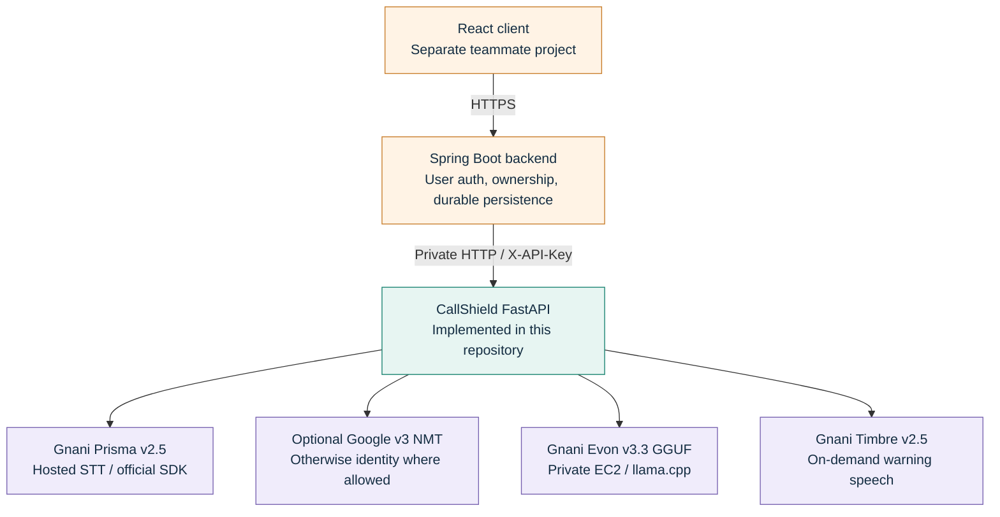
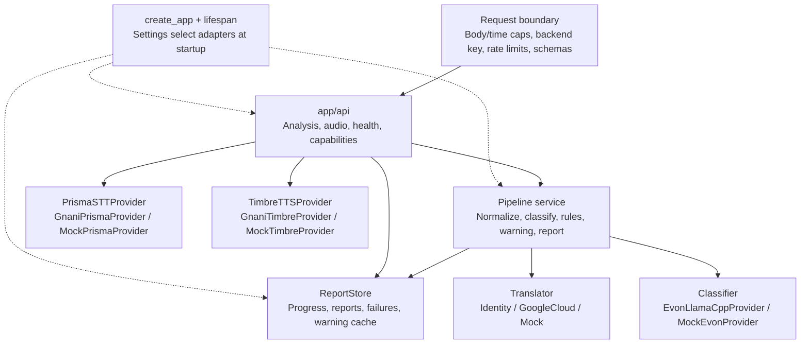
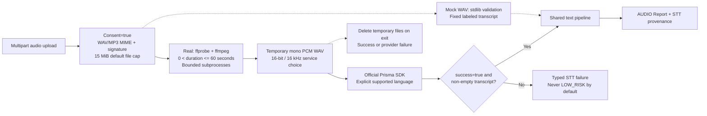
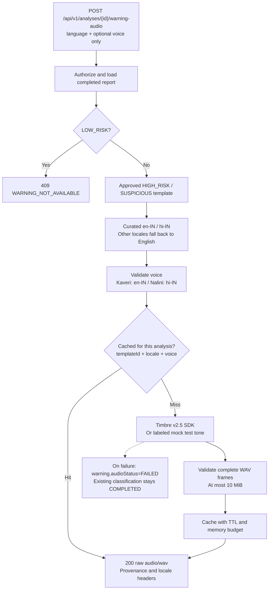
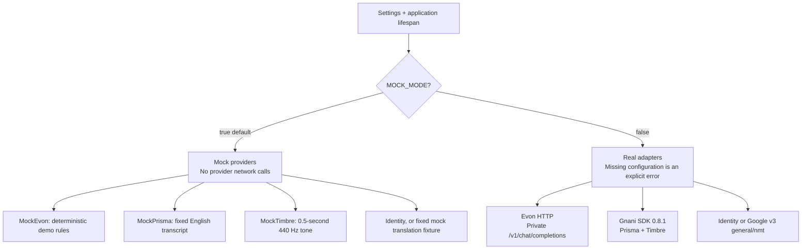
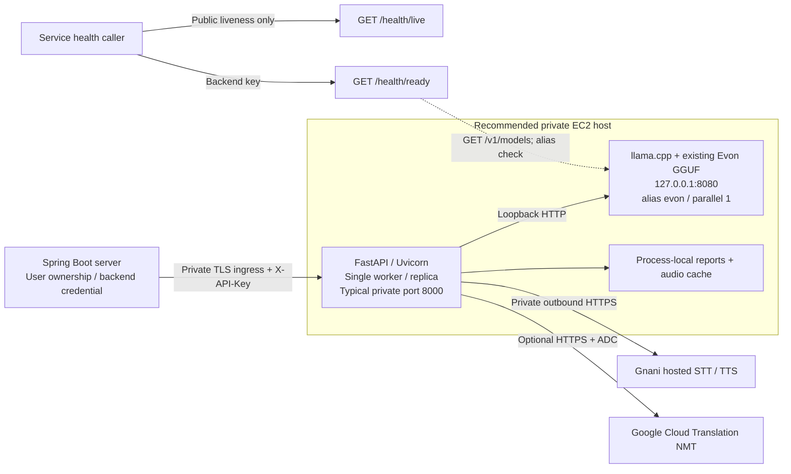
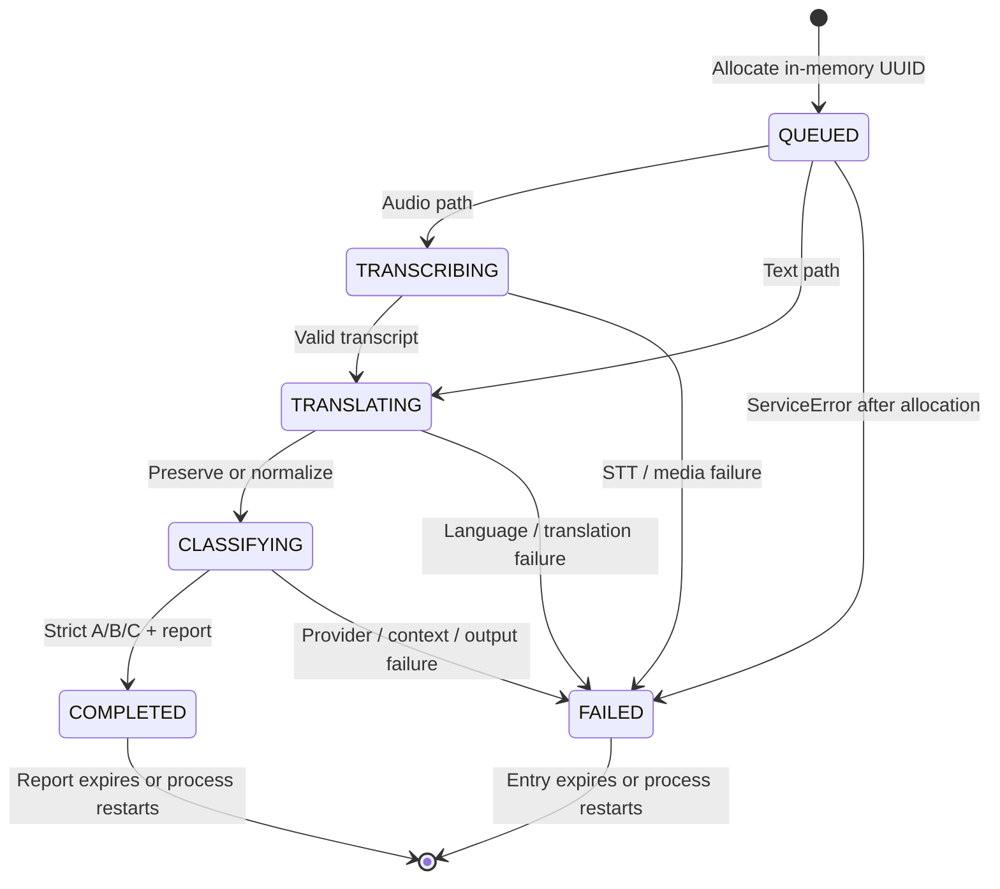

# CallShield India: architecture and technical diagrams

Source snapshot: **20 October 2026**. These diagrams describe the implementation in this repository. React and Spring Boot are separate teammate projects; the EC2 deployment is the recommended topology, not an assertion that EC2 is running. Real provider adapters exist; cloud execution requires credentials and connectivity. M6 simulations/window aggregation are not implemented.

Share the PDF for review, individual PNGs for chat/slides, and SVGs for scalable editing. Mermaid blocks below can be edited in a Mermaid-compatible Markdown viewer. Diagrams use the default configuration unless noted. This documentation makes no provider network calls and contains no credentials.

## 1. System context and ownership



Python owns orchestration, not user accounts or durable storage. Spring must enforce per-user report ownership before forwarding any analysis ID. The service uses one trusted backend principal; user identity headers are not an authorization mechanism.

Code: `app/main.py`, `app/core/auth.py`, `app/services/pipeline.py`.

## 2. Python components and adapter seams



The interface contracts use Python protocols and small result dataclasses. `Prisma` refers to Gnani speech recognition, not the Prisma database ORM. Report storage is an in-memory implementation, with no database included.

Code: `app/providers/interfaces.py`, `app/services/*`, `app/api/*`, `app/main.py`.

## 3. Text request sequence

```mermaid
sequenceDiagram
    participant Spring
    participant API as API / security
    participant Pipeline
    participant Translator
    participant Evon
    participant Store as ReportStore
    Spring->>API: POST /api/v1/analyze/text + X-API-Key
    API->>API: Validate body, authorize, rate-limit
    API->>Pipeline: Analyze validated request
    Pipeline->>Store: Allocate UUID, QUEUED
    Pipeline->>Store: TRANSLATING
    Pipeline->>Translator: Preserve or normalize transcript
    Translator-->>Pipeline: NormalizedText + provenance
    Pipeline->>Store: CLASSIFYING
    Pipeline->>Evon: Bounded non-thinking chat request
    Evon-->>Pipeline: Exact A/B/C, finish_reason=stop
    Pipeline->>Pipeline: Grounded rules + approved warning
    Pipeline->>Store: Save COMPLETED Report
    Pipeline-->>Spring: 200 Report JSON
    Note over Pipeline,Evon: Invalid output -> 502; unavailable -> 503; timeout -> 504; busy -> 429
    Note over Pipeline,Store: A ServiceError is saved as FAILED after UUID allocation
```

Identity policy preserves English/Hinglish and Hindi by default. `auto` preserves the text and reports `und` / `unknown`; it does not detect language. Regional inputs, and Hindi when explicitly configured for translation, require translation. Both original and normalized text remain in the report.

Evon has one active request, four waiting slots, five-second queue wait, and a 120-second upstream timeout by default. Its context guard counts message UTF-8 bytes plus 64 reserved tokens against the configured budget (512 default). It rejects over-budget input without truncation. `chat_template_kwargs.enable_thinking=false` is mandatory; confidence remains null. Mock classification does not simulate the real tokenizer budget.

Code: `app/api/routes_analysis.py`, `app/services/pipeline.py`, `app/services/language_policy.py`, `app/providers/evon_llamacpp.py`.

## 4. Audio upload pipeline



Mock WAV uploads do not require FFmpeg; MP3 needs FFmpeg in either mode. Real uploads always use ffprobe/ffmpeg. `auto` and `hi-Latn` are rejected as STT language inputs. Prisma REST metadata does not fabricate diarization, alignment, duration or confidence. `uploadDurationMs` is separately measured by this service. Client filenames are ignored and subprocess commands disable external protocols.

Code: `app/api/routes_audio.py`, `app/services/audio_utils.py`, `app/providers/gnani_prisma.py`.

## 5. Warning synthesis and caching



Cache is per report; the aggregate audio budget is 32 MiB. Earlier-expiring warning blobs are evicted first without deleting risk reports. Audio TTL is one hour but cannot outlive report retention or eviction. GET on the same warning-audio route serves cached bytes using `language` and optional `voice` query parameters, or 404. Template localization is curated in the active synthesis path; Google warning translation is not enabled.

Code: `app/api/routes_audio.py`, `app/services/warnings.py`, `app/providers/gnani_timbre.py`, `app/services/report_store.py`.

## 6. Mock and real provider selection



All mocked stages return explicit provenance. Curated warning text and identity preservation are not themselves fabricated provider output. Real mode never falls back to mock predictions. Speech adapters use the official SDK with `GNANI_API_KEY`; Evon can use its separately configured key. Speech work is bounded to two running and four waiting operations per adapter; Google uses a two-thread limiter. SDKs execute away from the FastAPI event loop.

Code: `app/main.py`, `app/config.py`, `app/providers/mock_providers.py`, `app/providers/gnani_common.py`.

## 7. Deployment and security boundaries



Do not expose llama-server port 8080 publicly. If Python is elsewhere, use a private network, VPN or authenticated tunnel. Container loopback is the container, not the EC2 host. Compose is local mock development: loopback binding, non-root image, read-only root and bounded temporary storage. All service routes except `/health/live` authenticate when a key is set; real/production mode requires a key of at least 24 characters. CORS is disabled. API responses disable caching; transcript logging is absent by default.

An unavailable Evon produces readiness and classification 503. Speech readiness is `configured_not_probed`, not proof of valid quota/authentication. No database/distributed lock/queue is implemented; multiple workers would break shared result retrieval and global Evon admission control.

Code: `Dockerfile`, `docker-compose.yml`, `app/core/auth.py`, `app/api/routes_health.py`, `app/main.py`.

## 8. Result states and integration contract



POST is synchronous: success is HTTP 200, failures carry a typed HTTP status and error envelope. No 202 job API exists. A known ID can be retrieved while processing; GET returns progress, a completed report, or a saved failure. Saved failure retrieval uses HTTP 200 with `status=FAILED`; callers must check body status. Missing/expired IDs return 404.

Default store: 500 reports, 30-minute TTL, periodic cleanup within at most 30 seconds of expiry. Successful completion refreshes report TTL. Early validation errors can have `analysisId=null`. The service's `UNDETERMINED` is operational, not a fourth model class. TTS failure changes warning state, not the COMPLETED risk state.

| Boundary | Teammate handling |
|---|---|
| Successful report | Preserve original and normalized text, warning, provider provenance and mock flags |
| Risk code A / B / C | HIGH_RISK / SUSPICIOUS / LOW_RISK; confidence is always null |
| Classification error | Show UNDETERMINED, never assume LOW_RISK |
| TTS response | Raw WAV bytes, not JSON/base64; honor locale and mock headers |
| Retry | Do not automatically replay paid analysis/synthesis requests |
| Ownership | Spring checks logged-in user ownership of each UUID before proxying |
| Persistence | Spring saves durable results; Python entries disappear on restart |
| Capabilities | Enable supported UI features from the current service configuration |

Code: `app/services/report_store.py`, `app/services/pipeline.py`, `app/api/routes_analysis.py`, `app/schemas/responses.py`.

## Rebuild the visual pack

Install the authoring dependency separately from service dependencies: `pip install reportlab`.

```powershell
python scripts/generate_architecture_diagrams.py
# Optional PNG export when Poppler is on PATH:
pdftoppm -scale-to 1600 -png output/architecture/CallShield_Architecture_and_Technical_Diagrams.pdf output/architecture/page
```

The generator draws editable SVGs and a vector PDF. The Markdown/Mermaid file is the conceptual editing source; the Python generator controls the composed visual layout. Keep both in sync when architecture changes. Application code was not changed for this documentation task.
